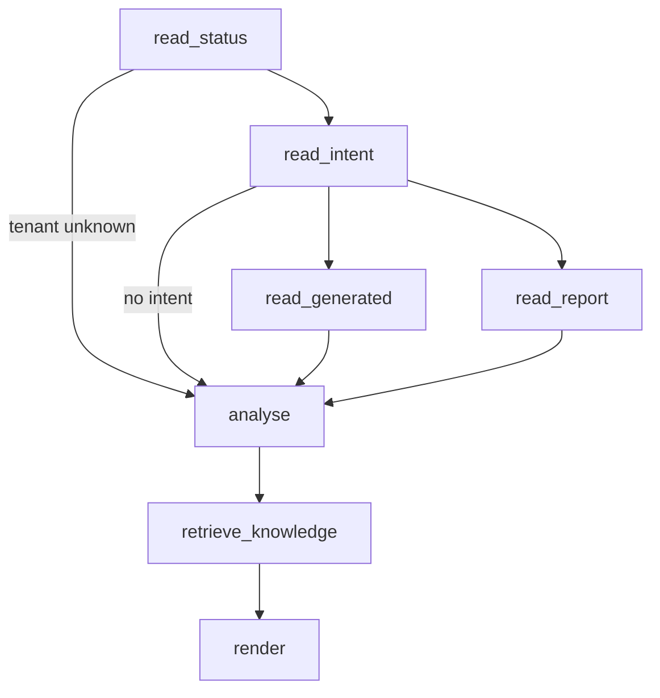

# ADR-022 — LangGraph Reasoning Layer as a Read-Only-First MCP Client

**Status:** Proposed — the read-only diagnosis workflow is implemented and was run against the lab; adopting the layer as a whole, and every write workflow, awaits team acceptance.

**Date:** 2026-10-17

**Decision Makers:** Platform Engineering Team

**Related ADRs:**

- ADR-008 — Validation as an Independent Platform Capability
- ADR-010 — AI as an Engineering Assistant
- ADR-012 — Centralized Secrets Management
- ADR-016 — Platform v2 Replacement Architecture
- ADR-017 — Execution Framework
- ADR-018 — NetAsCode YAML as the Authoritative Intent Artifact
- ADR-019 — Three Truths Principle (names LangGraph as the future owner of Business Intent)
- ADR-020 — ACI Domain Coverage Expansion (tool catalogue)

---

# Context

[`Future-AI-Integration-Design.md`](../ai/Future-AI-Integration-Design.md) approved a design for a LangGraph reasoning layer on 2026-07-28 and deferred building it. ADR-019 assigned it Business Intent and multi-domain coordination. Neither decided *how* it reaches platform state, *which* credentials it may hold, *what* it may write, or *where* to start. This ADR makes those decisions, informed by a working prototype.

Two kinds of recurring cost motivated starting now.

**Diagnosis is manual and slow.** "Why don't I see BGP on the APIC?" took one session of hand-correlating Nautobot, the generated YAML, two Terraform state files, GitLab job logs and direct APIC queries. The answer existed in pieces in four systems plus the knowledge base, which already documents the causes. Pipeline 60 (2026-10-15) is the canonical example: `terraform_apply` reported **116 resources added**, and the pipeline still failed because APIC raised **19 new faults** — readable only by opening the `verify_apic_faults` job log.

**Sequencing is ad hoc.** Multi-step work (a protocol L3Out is ten or more MCP calls in a fixed order) is ordered by whichever AI agent is active, with no plan review, no read-back after writes, and nothing that survives the session. The 2026-09-15 PBR lab — every MCP call returned HTTP 200 and nothing persisted, because a Custom Field was undeclared — is the failure that a read-back step would have caught.

The platform's existing rules constrain any solution:

- ADR-010: AI is a platform client and never receives privileged or direct access to execution engines.
- ADR-016 / Reference Architecture §1: the MCP Server must never become an orchestration engine.
- ADR-017 / ADR-001: changes enter only through Stage 1 (Intent); approval stays a human gate in GitLab.

---

# Problem Statement

How can the platform gain stateful, multi-step reasoning across Nautobot, Git, GitLab, APIC evidence and the knowledge base, without giving an AI component credentials, without moving orchestration into the MCP Server, and without letting a probabilistic model decide what is true about the infrastructure?

---

# Decision

## 1. LangGraph is adopted as a separate component, and it is an MCP client

The reasoning layer lives in `reasoning/` (package `platform_reasoning`), as its own deployable with its own dependencies. It is neither part of the MCP Server nor a GitLab CI job. It connects to the MCP Server exactly as VS Code Copilot does.

## 2. All platform state is read through MCP tools

Nautobot, GitLab and APIC evidence are read **only** through MCP tools. The reasoning layer has no Nautobot client, no GitLab client and no APIC client. The one exception is the knowledge base, which it reads from the repository: that is documentation, not live state, and needs no credential.

Where a needed read did not exist, it was added as an MCP tool rather than given to the reasoning layer as a direct API call.

## 3. The reasoning layer holds no infrastructure credential

No Nautobot token, GitLab token, APIC password or Vault token is present in the reasoning process. The MCP Server keeps its own service credentials (Reference Architecture §7.3's second boundary), sourced from Vault.

## 4. Read-only first

The first workflows write nothing. A workflow may write only through MCP write tools, and only once the prerequisites in §Gates are met. Read-only is enforced in code (see Mandatory Rules), not by convention.

## 5. Findings are deterministic; a language model never decides one

Every finding the diagnosis reports is computed by plain code from MCP payloads, so the same inputs always produce the same verdict. A language model may later be added to phrase a report or propose a plan, never to determine a fact, classify a fault, or approve anything. The prototype contains no LLM.

## 6. The reasoning layer never approves or starts a pipeline

The GitLab manual `terraform_apply` gate stays with a human. A workflow that reaches that gate stops and says so. It does not start pipelines either; the Nautobot webhook remains the only trigger.

## 7. Observed state comes from the pipeline's own verification evidence

For now, "what APIC did with the change" is read from the pipeline's `verify_apic_faults` result through `get_pipeline_report`. That is ADR-019's Truth #3 as recorded by the Stage 6 verification, and it requires no new credential anywhere.

A **live** APIC read (current managed-object state, `formed`/`unformed`, faults raised after the pipeline) is deliberately **not** decided here. It would give the MCP Server an APIC credential for the first time, which needs its own decision: a read-only APIC account in Vault, and an explicit rule that the MCP Server never writes to APIC.

## 8. Knowledge retrieval starts as keyword search

The knowledge base is searched by keyword over `knowledge/**/*.md`, with `archive/` excluded and table rows excluded from ranking. A vector store is added only if keyword retrieval demonstrably fails on real questions.

---

# Mandatory Rules — and where each is enforced

| Rule | Enforced by | Test |
|---|---|---|
| Diagnosis cannot call a write tool | `READ_ONLY_TOOLS` allowlist in `reasoning/src/platform_reasoning/mcp_reader.py`; a refused call raises before any request is sent | `test_a_write_tool_is_refused_before_anything_is_sent`, `test_the_allowlist_contains_no_writing_tool` |
| Diagnosis aborts if the MCP Server lacks a required read tool | `REQUIRED_TOOLS`, checked against `list_tools` at connect time | live run |
| No infrastructure credential in the reasoning process | the package has no Nautobot, GitLab or APIC client, and reads no token from the environment | code review; `pyproject.toml` dependencies are `langgraph`, `mcp`, `PyYAML` only |
| A tool error does not become a false "OK" | errors are recorded per layer; an unreadable layer is reported as unknown, never as ok | `test_a_tool_error_is_recorded_and_the_run_still_completes` |
| An unverifiable fault check is never "clean" | `parse_fault_check` returns `unverifiable` for APIC fail-closed output and `unrecognised` for unknown output | `test_fault_check_unreachable_apic_is_unverifiable_not_clean`, `test_unrecognised_output_is_never_reported_as_clean` |
| Transient failures retry; deterministic ones do not | LangGraph `RetryPolicy` on read nodes, retrying only non-tool errors | `test_a_transient_failure_is_retried` |
| A past diagnosis is never cited as evidence for the next one | `knowledge.py` skips this ADR and blanks any line linking to it, keeping line numbers exact | `test_the_reasoning_layers_own_records_are_never_cited` |

---

# Workflow 2 — Read-Only Deployment Diagnosis (implemented)

Given a tenant, and optionally an object name, follow it through four layers and report the first layer where it stops.

| Layer | Source of truth | Read through |
|---|---|---|
| 1 intent | Nautobot | `show_status`, `get_tenant_intent` |
| 2 generated | NetAsCode YAML the pipeline's Terraform consumed | `get_generated_intent` |
| 3 execution | GitLab pipeline: plan, approval, apply | `get_pipeline_report` |
| 4 observed | APIC fault delta from `verify_apic_faults` | `get_pipeline_report` |



Faults are classified into known **families** by pattern only. What a family *means* is retrieved from the knowledge base at run time and cited by file and line, so an explanation always points at the evidence that established it rather than at text embedded in code. Two families exist today, both measured in ADR-020: **switch absence** (`Node Not Leaf` / `Node Cannot Deploy`, no registered leaf) and **L4-L7 without a concrete device** (`lDevVip` / `AbsGraph` / `CDev` faults, rooted in `vnsConfIssue-missing-cdev`). Any other fault is reported as **unexplained**, and that turns layer 4 from a warning into a stop.

Run it:

```powershell
cd reasoning
$env:PYTHONPATH = 'src'
.venv/Scripts/python -m platform_reasoning diagnose --tenant sales --object BGP_L3Out
.venv/Scripts/python -m platform_reasoning diagnose --tenant sales            # whole tenant
.venv/Scripts/python -m platform_reasoning diagnose --tenant sales --pipeline 59
```

The MCP Server must be running (`docker/mcp-server`, port 8071) and include the two tools below.

---

# Implementation and Evidence (2026-10-17)

## MCP Server — two read-only tools, live-verified

| Tool | Domain | What it returns |
|---|---|---|
| `get_pipeline_report` | generic | One pipeline's jobs and statuses, jobs awaiting manual approval, Terraform plan/apply summaries and errors, and the parsed APIC fault check (code, severity, lifecycle, DN, description per new fault). Without an id, the newest pipeline that actually ran, skipping `[skip ci]` pipelines |
| `get_generated_intent` | cisco_aci | One tenant's block from the `generate_nac` **artifact** of a pipeline: the exact file Terraform consumed. Falls back to the repository copy **with a warning** when the artifact is gone |

Both use the MCP Server's existing least-privilege GitLab token (`mcp_status_reader_token`, `read_api`), which was confirmed able to read job logs, artifacts and repository files. No new credential was introduced. `PyYAML` was added to the MCP Server's dependencies.

**Live-verified, 16/16 checks over the real MCP protocol, each cross-checked by a direct GitLab read:** pipeline 60's apply `116/0/0` and all 20 job statuses matched; 19/19 faults parsed with DN and description, matching the raw job log; pipeline 59's unapproved `terraform_apply` reported as awaiting approval with its log not read; the default resolved to the newest pipeline that ran; tenant `sales` was identical to the raw artifact; `ACI:sales` resolved to the generator's bare name; pipeline 59's expired artifact fell back with a warning; an absent tenant reported `tenant_present: false`. The catalogue is now 137 tools, 108 live-verified.

One defect was found and fixed while building the test fixtures: the parsed fault-check verdict (`new_faults`) overwrote the job's own status under the same key. The job status is now `job_status`.

## Reasoning layer — live-run against the lab

| Question | Verdict |
|---|---|
| tenant `sales`, object `BGP_L3Out` | Stops at **layer 4**: 1 fault, switch absence (F1298 on external EPG `Nexus_ExtNet`, node 101). Cites ADR-020 and the status tracker |
| tenant `sales`, object `FW` | Stops at **layer 4**: 8 faults, all L4-L7 without a concrete device (`missing-cdev`). Cites ADR-020's measured 10-fault floor. `FW_SGT`'s faults correctly not attributed to `FW` |
| tenant `sales`, whole tenant | 19 new faults: 9 switch absence, 10 L4-L7, **0 unexplained** — the same split the status tracker recorded by hand |
| tenant `sales`, `BGP_L3Out`, pipeline 59 | Stops at **layer 3**: planned `+65`, `terraform_apply` never approved |
| tenant `sales`, `BGP_L3OUT` (typo) | Stops at **layer 1**, suggests `BGP_L3Out` |
| tenant `nosuchtenant` | Stops at **layer 1** after a single MCP call (conditional edge skips every other read) |

Every run reported `0 writes`. Evidence level of the workflow itself: **live-run, read-only**. There is nothing to apply or destroy.

**Offline tests:** 35 in `reasoning/tests/` (allowlist, payload decoding, every layer's stop condition, fault attribution, retrieval ranking, self-citation exclusion, graph routing, retry, error recording), plus parser and dispatch tests for both new tools in `mcp-server/tests/unit/` (771 passing).

**A second defect, found by re-running the diagnosis after this ADR was written:** the tenant-level run began citing the status tracker's own note *about the diagnosis* as the explanation for both fault families — the tool was quoting its earlier output back as evidence. Retrieval now skips this ADR and every line that links to it.

---

# Gates — prerequisites before any write workflow

A workflow that writes (guided build, decommission, drift correction) may not be built until all of these hold:

1. **MCP client authentication is enforced.** Found while building this: `MCP_API_KEY` is declared in `mcp-server/src/mcp_server/config.py` and set by the compose file, but nothing reads it. Any process that can reach port 8071 can call every tool, deletes included. Acceptable on this isolated lab; not acceptable for an autonomous writer. The reasoning layer then gets its own per-client key.
2. **A durable checkpoint store.** A write workflow pauses at the plan review and at the GitLab approval gate, possibly for hours. Its state must survive a restart: a dedicated Postgres database, never Nautobot's.
3. **Human approval is an interrupt, not a step.** Plan review uses LangGraph's `interrupt`. The `terraform_apply` gate stays in GitLab; the workflow waits for it and never presses it (Decision 6).
4. **Read-back after every write.** Each write is confirmed with `get_tenant_intent` / `get_fabric_intent` before the next, so a silently discarded write stops the workflow.
5. **Per-workflow evidence.** Each workflow is recorded in this ADR with its own evidence level, following the CLAUDE.md Definition of Done.

---

# Roadmap

| Order | Workflow | Writes | Status |
|---|---|---|---|
| 1 | Read-only deployment diagnosis | no | **Implemented, live-run** |
| 2 | Approval assistant: summarise a pending plan (counts per resource type, every destroy, resources marked `# EVIDENCE:` or `NOT-SETTABLE`) before a human approves | no | Not started; needs a plan-content read tool |
| 3 | Drift report: compare intent with observed state, report only, never import (ADR-001 managed state) | no | Not started; needs the live APIC read in Decision 7 |
| 4 | Guided build (ordered MCP writes, plan review, read-back, wait for approval, verify, explain) | yes | Blocked on Gates |
| 5 | Safe decommission (impact analysis, reverse-order unbind/delete, verify gone on every layer) | yes | Blocked on Gates |
| 6 | Lab guide to intent (extract objects from a lab document, diff against intent, build what is missing) | yes | Blocked on Gates; needs an LLM node for extraction |
| 7 | Multi-domain business operation (ACI + EVPN subgraphs, ADR-019) | yes | Blocked on Gates |

---

# Alternatives Considered

## Option 1 — Keep ad hoc sequencing by the active AI agent

No new component. Rejected for multi-step and diagnostic work: nothing survives the session, nothing reads back after a write, and diagnosis remains manual correlation. Single-tool requests are still best served this way, and remain so.

## Option 2 — Orchestrate inside the MCP Server

Rejected. ADR-016 and the Reference Architecture forbid the MCP Server from becoming an orchestration engine. The server gains only thin read tools.

## Option 3 — Give the reasoning layer direct Nautobot, GitLab and APIC clients

Simpler, and rejected. ADR-010 forbids AI holding privileged access, and it would duplicate the MCP Server's error mapping and credential handling. Every missing read was added as an MCP tool instead.

## Option 4 — An LLM agent that diagnoses by reading raw payloads

Rejected for findings. Its verdict would not be reproducible, and on this platform "it worked" has repeatedly been wrong in ways only exact checks catch (a clean plan that emitted zero OSPF resources; an apply with 19 faults). An LLM remains welcome for phrasing and planning.

## Option 5 — CrewAI or AutoGen

Listed as alternatives in `Technology-Architecture.md`. LangGraph was chosen for an explicit state graph with conditional routing, parallel branches, per-node retry policy, durable checkpoints and first-class human interrupts — each of which a write workflow needs.

## Option 6 — A vector store from day one

Deferred (Decision 8). Keyword retrieval cited the correct ADR-020 sections for both fault families on the first live run.

---

# Consequences

**Positive**

- A question that took a session of manual correlation is answered in one command, with the layer it stops at, the faults involved, and the documents that already explain them.
- The diagnosis cannot change platform state, and that is enforced and tested, not assumed.
- Two generally useful read tools exist for every MCP client, not only for LangGraph: a Copilot session can now read a pipeline's real outcome instead of its green apply job.

**Negative / accepted**

- A new component with its own dependencies (`langgraph`, `mcp` 2.x) and virtualenv.
- `get_pipeline_report` depends on the output format of `check_apic_faults.py`. A format change is reported as `unrecognised`, never as clean, but it would degrade the diagnosis until the parser is updated.
- `generate_nac` artifacts expire after one week, so diagnosing an older pipeline reads the repository copy, flagged with a warning because it can differ from what was applied.
- Observed state is the pipeline-time fault delta. Faults raised, or drift introduced, after the pipeline are invisible until Decision 7 is taken.
- Only two fault families are classified. Anything else is "unexplained": correct, but it means a new fault class needs a pattern and a knowledge-base entry before it is explained.
- `get_generated_intent` is ACI-only; EVPN diagnosis needs its own read tool.

---

# Relationship to Other Components

| Component | Role in this decision |
|---|---|
| MCP Server | Only path to platform state; gains read-only tools; keeps every credential |
| Nautobot | Read for intent through MCP; never written by the diagnosis |
| GitLab | Read for the generated artifact, job outcomes and fault delta through MCP; its manual gate stays human |
| Vault | Never touched by the reasoning layer |
| OPA | Unchanged; a future workflow may explain a denial, never bypass it |
| Knowledge base | Read directly from the repository as the retrieval corpus |
| Language model | Not used yet; may phrase and plan, never decide or approve |

---

# Summary

LangGraph is adopted as a separate reasoning component that reaches the platform only as an MCP client, holds no infrastructure credential, and starts read-only. Its first workflow, a four-layer deployment diagnosis, is implemented, tested, and has been run against the lab, where it reproduced, in one command each, conclusions that previously took hours of manual correlation. Write workflows are deliberately gated on client authentication, durable checkpoints, interrupts at every human decision, and read-back after every write.
